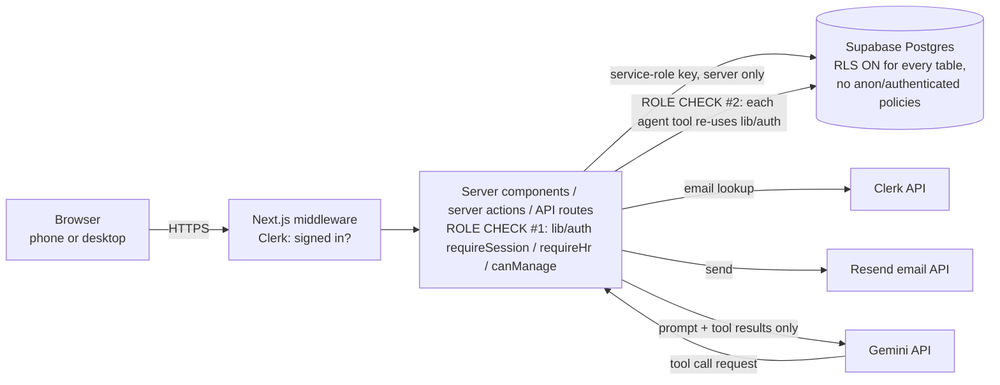
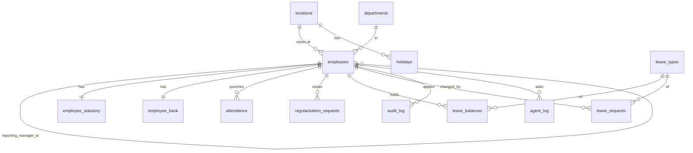

# ARCHITECTURE.md — Lehar HRMS

> Owner's note: this is the technical record the code is built against. Review every decision and be ready to defend it in the viva; change anything you disagree with here first (Decision log), then in code.

## 1. Stack

| Layer | Choice | Why | Rejected alternative |
|---|---|---|---|
| Framework | Next.js 15 (App Router, TypeScript) | Pages, server actions and API routes in one project; server components let every page do its role check on the server before any HTML is sent | Express API + React SPA: two deployments and role checks split across them |
| Hosting | Vercel (free Hobby tier) | Zero-config deploys from GitHub, preview URLs, env vars per environment | Render free tier: cold starts of 30–60 s on the free plan |
| Database | Supabase Postgres (free tier) | Real Postgres: unique / check / foreign-key constraints, sequences for employee codes, `plpgsql` functions for atomic balance changes, row-level security | Firebase Firestore: no relational constraints, so "one attendance row per day" would rely on app code |
| Auth | Clerk (free tier) | Hosted sign-in, email codes, test-mode emails for demo users. Clerk only proves *who* the user is; the role comes from our database | Supabase Auth: would work, but Clerk is the course default and keeps auth separate from data |
| Email | Resend (free tier, 100/day) | One HTTP call, works from Vercel. If no key is set, mails are written to the server log so the app still works | Gmail SMTP: app passwords, rate limits and spam issues |
| AI agent | Vercel AI SDK v5 + Google Gemini Flash (`gemini-flash-latest`, free tier; override with `AGENT_MODEL`) | AI SDK gives typed tools (`zod` schemas), multi-step tool calling and a chat UI hook. Gemini free tier allows ~10 requests/min, ~250/day for Flash (check current limits before the demo) | Groq Llama: fast, but tool calling with long schemas was less reliable in testing |
| Tests | Vitest | Fast, TypeScript native, runs pure business-rule functions without a database | Jest: slower TS setup |

## 2. System diagram



Role checks happen in exactly one place: `lib/auth`. Every page calls `requireSession()` (or `requireHr()` / `requireManagerOrHr()`), and every server action and API route calls the same helpers before touching data. The browser never talks to Supabase directly, and the model never sees a key.

## 3. Data model



| Table | Columns (key ones) | Constraints |
|---|---|---|
| `locations` | id, name, city, state, weekly_off_days int[] (0=Sun … 6=Sat) | name unique; weekly_off_days values 0–6 |
| `departments` | id, name | name unique |
| `employees` | id, clerk_user_id, employee_code, full_name, email, mobile, dob, gender, address_line, city, state, pin_code, date_of_joining, last_working_day, designation, grade, department_id, location_id, reporting_manager_id, is_hr_admin, emergency_name, emergency_relation, emergency_mobile, created_at | employee_code unique, default `'KCF' || lpad(nextval(seq),4,'0')`, never updated (trigger blocks change); email unique (case-insensitive); clerk_user_id unique; mobile `^[6-9][0-9]{9}$`; pin `^[0-9]{6}$`; gender check; `dob <= date_of_joining - 18 years`; `reporting_manager_id <> id`; `last_working_day >= date_of_joining` |
| `employee_statutory` | employee_id PK/FK, pan, aadhaar, uan | pan `^[A-Z]{5}[0-9]{4}[A-Z]$`; aadhaar `^[0-9]{12}$`; uan null or `^[0-9]{12}$`; pan unique; aadhaar unique; **RLS on** |
| `employee_bank` | employee_id PK/FK, account_number, ifsc, bank_name | ifsc `^[A-Z]{4}0[A-Z0-9]{6}$`; account 9–18 digits; **RLS on** |
| `holidays` | id, location_id, date, name, type | type in (National, State, Optional); unique (location_id, date) |
| `attendance` | id, employee_id, date, check_in, check_out, is_wfh, is_late, regularised | **unique (employee_id, date)**; check_out > check_in |
| `regularisation_requests` | id, employee_id, date, attendance_id (nullable), requested_in, requested_out, reason, status, approver_id, approver_comment, decided_at, created_at | status in (pending, approved, rejected); requested_out > requested_in; one pending request per employee per date (partial unique index) |
| `leave_types` | id, code, name, annual_quota, accrual_method, carry_forward_max, half_day_allowed, requires_certificate_after_days, count_calendar_days, gender_restriction, is_active | code unique; accrual_method in (annual_prorated, monthly, on_request, none) |
| `leave_balances` | id, employee_id, leave_type_id, year, opening, used | unique (employee_id, leave_type_id, year); opening ≥ 0; used ≥ 0 |
| `leave_requests` | id, employee_id, leave_type_id, from_date, to_date, is_half_day, days, reason, status, approver_id, approver_comment, attachment_url, decided_at, created_at | status in (pending, approved, rejected, cancelled); to_date ≥ from_date; half day ⇒ from = to and days = 0.5; same calendar year |
| `audit_log` | id, table_name, record_id, field, old_value, new_value, action, reason, changed_by, changed_at | action in (create, update, reveal, deactivate, correct) |
| `policy_documents` | id, key, title, body, updated_at | key unique — the only text `explain_policy` may use |
| `agent_log` | id, employee_id, tool, inputs jsonb, result jsonb, created_at | — |

**Answers to the three design questions**
- *Why are statutory and bank details separate?* RLS is per table. Putting PAN/Aadhaar/bank in their own tables lets us lock those tables completely (RLS on, no policies, privileges revoked from `anon` and `authenticated`) while the rest of the employee row is read in many screens. A query that loads an employee list can never accidentally pull Aadhaar because it is not on that row.
- *Stored or calculated available balance?* Calculated: `available = opening + accrued − used − pending`. If it were stored, every approve, reject, cancel, accrual month and back-dated correction would have to update it in the same transaction, and one missed path (or a manual DB fix) silently makes it wrong forever. `accrued` is also calculated in code from the leave type and joining date; `pending` is the sum of pending requests.
- *What stops two attendance rows on the same date?* The `unique (employee_id, date)` constraint. Check-in uses `insert … on conflict do nothing`, so two clicks or two tabs still produce one row.

## 4. Access control

1. Clerk middleware blocks every route except `/sign-in` and `/access-denied` for signed-out users.
2. `lib/auth/session.ts → getSession()` reads the Clerk user's primary email, finds the `employees` row by email (case-insensitive), and stores `clerk_user_id` on first login.
3. If no row is found, or `last_working_day` is before today (IST), the user is sent to `/access-denied`.
4. Role: `isHr = employees.is_hr_admin`; `isManager = exists(active employee with reporting_manager_id = me)`. Nothing about the role is stored in Clerk.
5. Helpers: `requireSession`, `requireHr`, `requireManagerOrHr`, `canViewEmployee(session, id)` (self or HR), `canManageEmployee(session, id)` (HR, or direct manager of an active employee). Every page, server action and API route calls one of them.

| Table | RLS | Rule |
|---|---|---|
| all tables | ON | No policies for `anon` / `authenticated` ⇒ the public anon key can read nothing. Only the server (service role) reads data, after `lib/auth` checks. |
| `employee_statutory`, `employee_bank` | ON + `revoke all … from anon, authenticated` | Server code selects these only in the profile loader, masks immediately, and only `revealSensitive()` (HR, logged) returns PAN/bank unmasked. Aadhaar is never returned unmasked by any function. |

## 5. Business logic location

All rules are **pure TypeScript functions** with unit tests, so the screens, CSV and agent tools share exactly one implementation:

| Rule | File · function |
|---|---|
| IST dates | `lib/dates/ist.ts` |
| Field validation (PAN, Aadhaar, UAN, IFSC, mobile, PIN, 18+) | `lib/employees/validation.ts` |
| Masking | `lib/employees/mask.ts` |
| Reporting loop | `lib/employees/reporting.ts → createsReportingLoop` |
| Day status, Late, late-LOP | `lib/attendance/rules.ts → computeDayStatus, isLate, lateLopDates` |
| Working-day count | `lib/leave/workingDays.ts → countLeaveDays` |
| Accrual, pro-rating, available | `lib/leave/balance.ts` |
| Apply-leave validation | `lib/leave/rules.ts → validateLeaveApplication` |
| Approve / cancel permissions | `lib/leave/rules.ts → canDecide, canCancel` |
| Month-end summary | `lib/reports/summary.ts` |

The database adds a second line of defence with constraints, and two `plpgsql` functions make balance changes atomic: `decide_leave_request` (approve moves days into `used` in the same transaction as the status change, and only if the request is still `pending`) and `cancel_leave_request` (restores `used` when cancelling approved future leave). `create_employee` inserts employee + statutory + bank + balances + audit in one transaction.

Day status is **calculated on read**, not stored: a holiday added later or a leave approved later is reflected immediately, and no nightly job is needed.

## 6. AI agent

- Library: Vercel AI SDK v5 (`streamText`, `tool`, `useChat`). Model: `gemini-flash-latest` via `@ai-sdk/google` (set `AGENT_MODEL` to pin a version).
- Route: `app/api/agent/route.ts`. It calls `requireSession()` first; tools are built per request by `lib/agent/tools.ts → buildTools(session)` and only include tools the user's role may use.

| Tool | Who | Input | Output |
|---|---|---|---|
| `get_my_leave_balance` | everyone | — | per type: opening, accrued, used, pending, available |
| `get_holidays` | everyone | year, month? | holidays for the user's location |
| `count_working_days` | everyone | from, to, half_day? | days, list of skipped weekly offs/holidays |
| `explain_policy` | everyone | topic | stored policy text only |
| `draft_leave_request` | everyone | leave_code, from, to, half_day, reason | a **draft** (days, balance after, problems). Nothing saved. |
| `get_team_today` | managers, HR | — | direct reports (HR: all) with today's status |
| `summarise_pending_approvals` | managers, HR | — | pending requests with balance and clash warnings |
| `flag_month_end_issues` (own tool) | HR | year, month | employees with 3+ Lates or missed punches + a draft reminder email |

- The model sees: the user's first name, role, location, today's IST date, and tool results. It never sees DB credentials, Aadhaar, PAN or bank data (no tool selects those tables).
- Writes: the only write-like tool returns a draft. The chat UI shows a draft card; **Confirm** calls the normal `applyLeave` server action, which re-runs every validation and role check.
- No tool can approve, reject or cancel.
- Limits: max 5 tool calls per question (counter in `buildTools`; the 6th call returns an error and the model must answer). Every call is written to `agent_log`.

## 7. Folder structure

```
app/(home)        /  dashboard, /settings
app/(employees)   /profile, /employees, /employees/new, /employees/[id], /employees/[id]/edit
app/(attendance)  /attendance, /attendance/team
app/(leave)       /leave, /leave/apply, /leave/calendar, /approvals
app/(reports)     /reports, /api/reports/csv
app/(agent)       /ask-hr, /api/agent (chat route)
lib/auth lib/dates lib/db lib/employees lib/attendance lib/leave lib/reports lib/agent lib/email
components/       shell, badges, calendar, forms
supabase/migrations/   SQL schema (single source of truth for tables)
scripts/seed.ts   seed data
scripts/run-agent-tests.ts   runs tests/agent/prompts.json against the real agent
scripts/dev/smoke.ts         integration checks against a seeded database
tests/<module>/   vitest tests
```

## 8. Dates and time zone

- Postgres stores instants as `timestamptz` (absolute time) and calendar days as `date`.
- The app never calls `new Date().getDate()` or similar local-time getters. `lib/dates/ist.ts` converts an instant to IST by adding +05:30 and reading UTC fields (India has no DST, so this is exact regardless of the server's time zone).
- `todayIST()`, `toISTDateString()`, `formatISTTime()`, `istDateTimeToUtc()` are the only helpers used for the "which day is this punch" question.
- Test: run `TZ=America/New_York npm test` and `TZ=Asia/Tokyo npm test` — results must not change.

## 9. Risks

| Risk | Why it could break | How it is tested |
|---|---|---|
| Leave balance drift | approve/cancel paths updating `used` twice or not at all | Balance changes only in two DB functions guarded by `status = 'pending'` / `'approved'`; unit tests on available-balance and cancel rules |
| Time zone bugs | Vercel runs in UTC; a 09:00 IST check-in is 03:30 UTC on the same day, but 00:30 IST is the previous UTC day | IST helper tests with times near midnight, run under several `TZ` values |
| Role bypass via URL or direct action call | A hidden button is not a check | Every page/action calls `lib/auth`; tests for `canViewEmployee`/`canDecide`; manual URL-tampering test in checklist |

## 10. Decision log

| Date | Decision | Reason |
|---|---|---|
| 2026-10-17 | `employees.status` replaced by `last_working_day`; "active" = no last working day or it is today/future (IST) | One source of truth; an employee stays able to log in on their last day and is blocked the next day without a job |
| 2026-10-17 | `attendance.status` not stored; computed by `computeDayStatus` | Holidays/leave added later change the status automatically; no nightly job |
| 2026-10-17 | `leave_balances.accrued` not stored; computed from leave type + joining date | EL grows every month; storing it needs a scheduled job and can drift |
| 2026-10-17 | Added `regularisation_requests.date` and `employee_id` (attendance_id nullable) | A missed punch may have no attendance row at all |
| 2026-10-17 | Added `leave_types.count_calendar_days` (Maternity only) | The Maternity Benefit Act grants 26 *weeks*, i.e. calendar days, not working days |
| 2026-10-17 | Added `policy_documents` and `agent_log` tables | Required by the agent: policy answers only from stored text; every tool call logged |
| 2026-10-17 | Late LOP: every 3rd Late in a calendar month (3rd, 6th, 9th …) adds 0.5 day LOP, calculated on read | Matches the rule "three Lates convert into one half day" and stays correct after regularisation |
| 2026-10-17 | A leave request must stay inside one calendar year | Balances are per leave year (Jan–Dec) |
| 2026-10-17 | Optional holidays are listed per location but stay working days (employee takes CL to use one) | Matches how restricted holidays work (research Q6); National and State holidays are days off |
| 2026-10-17 | Seed: the HR Admin reports to the Finance & Admin Manager | Otherwise nobody could approve HR's own leave (self-approval is blocked) |
| 2026-10-17 | LOP conversion uses whole days of balance (floor); the earliest working days use the balance, the rest become one LOP request | Keeps both requests as simple date ranges |
| 2026-10-17 | Agent model id `gemini-flash-latest` instead of a pinned version | Pinned preview ids are retired regularly on the free tier |
| 2026-10-17 | Login is allowed before the joining date (Home shows "starts on your first working day"); check-in is blocked until then | DESIGN.md empty state for new joiners |
| 2026-10-17 | Deactivation is blocked while the employee still has active direct reports | Their requests would have no approver |
| 2026-11-17 | When the Clerk or Supabase keys are missing, the root layout shows a "setup needed" page (variable names only) and the middleware lets requests through | A first Vercel deploy without keys crashed the build at prerender ("Missing publishableKey"). Data stays protected: every page and API route still goes through `lib/auth` |
