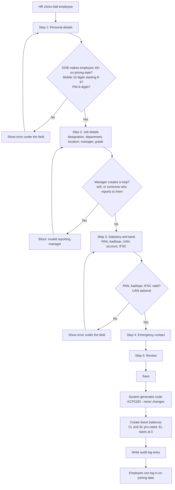
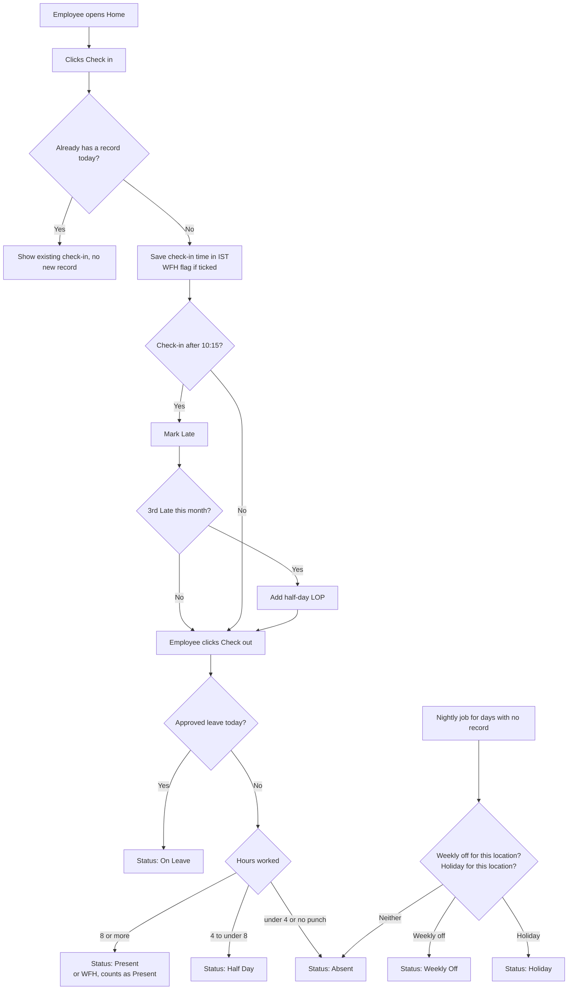
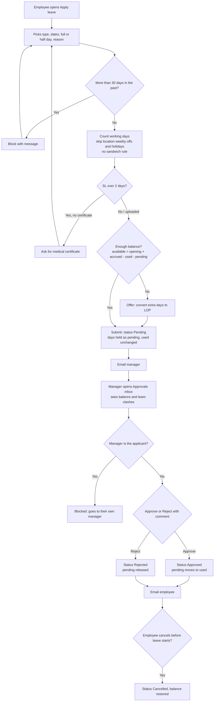
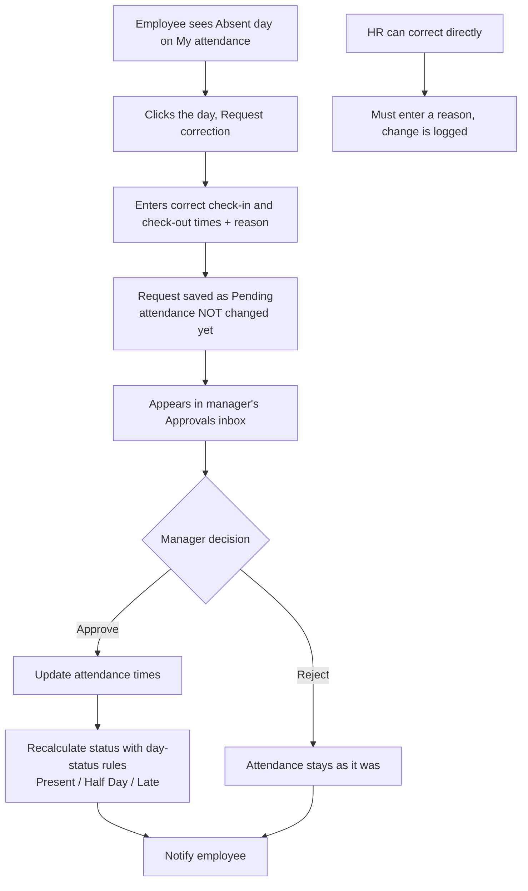

# DESIGN.md — Lehar HRMS

**Product:** Lehar (Hindi/Marathi for "wave", a nod to the Konkan coast)
**Company:** Konkan Coastal Foods · Panaji head office (HO) + Verna plant
**Screens:** see the Lehar design canvas (18 artboards). This document describes them and adds the user flows.

---

## 1. Design principles

1. **Zero clicks to the essentials.** Home shows the Check-in button and every leave balance without opening anything else.
2. **Numbers show their working.** Day counts list the weekly offs and holidays they skipped; balances split into opening, accrued, used and pending.
3. **Sensitive by default.** PAN, Aadhaar and bank numbers are always masked. Reveal is an HR-only, logged action. Aadhaar is never revealed.

---

## 2. User flows

### 2.1 Add employee (HR Admin)

### 2.2 Check-in to day status

### 2.3 Apply leave → approval → balance update

### 2.4 Missed punch → regularisation

---

## 3. Screens

| Screen | Who sees it | What it shows | Canvas artboard |
|---|---|---|---|
| Home dashboard | Everyone | Check-in button, today's status, Late count, leave balances, my pending requests; managers also see team today and requests waiting on them | Home dashboard |
| My profile | Everyone | Tabs: Personal, Job, Statutory, Bank, Emergency contact. Contact fields editable; job fields locked; statutory/bank masked | My profile |
| My attendance | Everyone | Month calendar colour-coded by status, summary counts, day detail, regularisation request form | My attendance |
| Apply leave | Everyone | Leave type cards with balances, dates, full/half day, reason, certificate upload; working-day breakdown; LOP conversion offer; balance after approval; team clash note | Apply leave |
| My leave | Everyone | Balance cards, breakdown table (opening, accrued, used, pending, available), request history with Cancel | My leave |
| Ask HR | Everyone | Chat, tools used under each answer, draft card with Confirm / Edit / Discard, refusals | Ask HR |
| Approvals inbox | Managers, HR | Pending leave and correction requests, detail with balance before/after, clash warning, comment, Approve / Reject | Approvals inbox |
| Team attendance | Managers, HR | Today's counts and list, month grid for direct reports | Team attendance |
| Leave calendar | Managers, HR | Team leave on a month view, approved vs pending, clash days highlighted | Leave calendar |
| Reports | Managers (own team), HR (all) | Month-end summary table, filters, CSV download, check that rows add up | Reports |
| Employee directory | HR Admin | Search, filters, table, side panel with masked IDs, Reveal (logged), audit trail, Deactivate | Employee directory |
| Add / edit employee | HR Admin | 5-step form with validation on every Indian field; employee code shown as auto-assigned | Add employee |
| Settings | HR Admin | Locations and weekly offs, leave types, holidays per location (National / State / Optional), departments, policy text for Ask HR | Settings |

### Phone layouts
Check-in, Apply leave and Ask HR are designed at 390 × 844:
- **Check-in:** large clock, 60 px Check in button, WFH toggle, three balance tiles, this-week strip, bottom tab bar (Home, Attendance, Leave, Ask HR, Me).
- **Apply leave:** type chips with balances, date pickers, half-day toggle, day-by-day breakdown (Fri ✓, Sat off, Sun off, Mon ✓ = 2 days), sticky Submit button.
- **Ask HR:** full-height chat, draft card with Confirm, quick-question chips, input at the bottom.

On desktop screens, the sidebar stacks above the content at phone width and wide tables scroll inside their card.

---

## 4. Design system

### 4.1 Colour palette

| Token | Hex | Use |
|---|---|---|
| Konkan Teal | `#0B4F4A` | Primary buttons, sidebar, logo |
| Teal Tint | `#E2EFEC` | Active/selected backgrounds |
| Saffron | `#E8833A` | Logo wave and highlights only (never text) |
| Saffron Ink | `#9A4A12` | Small labels on light backgrounds |
| Ink | `#15212B` | Body text (15.6:1 on white) |
| Slate | `#55606A` | Secondary text (6.3:1 on white) |
| Sand | `#F4F3EE` | App background |
| Line | `#E3E1DA` | Borders and dividers |
| Danger | `#A32014` | Errors, Reject, destructive actions |

All text meets WCAG AA contrast (4.5:1).

### 4.2 Status colours (used identically on every screen)

| Status | Code | Text | Background | Rule |
|---|---|---|---|---|
| Present | P | `#17663F` | `#DDF1E5` | 8+ hours worked |
| Work from home | WFH | `#0B6476` | `#DCF0F4` | Counts as Present |
| Half Day | HD | `#8A5300` | `#FCEFCF` | 4 to under 8 hours |
| Absent | A | `#A32014` | `#FBE2DE` | Under 4 hours or no punch |
| On Leave | L | `#2A50A8` | `#E1E9FA` | Approved leave wins over punches |
| Holiday | H | `#6B2FA0` | `#EEE4F8` | Per location |
| Weekly Off | WO | `#4F5862` | `#ECEDEF` | HO Sat–Sun, Plant Sun |
| Late | LT | `#A3410A` | `#FFE6D2` | Check-in after 10:15 |

Every status always shows its label or code as well, so colour is never the only signal.

Request statuses: **Pending** (`#7A5200` on `#FFF1C7`), **Approved** (green), **Rejected** (red), **Cancelled** (grey), **Draft** (dashed blue outline, needs Confirm).

### 4.3 Typography
- **Manrope** for all interface text; **IBM Plex Mono** for employee codes, masked IDs and agent tool names.
- Scale: Display 32/40 800 · H1 24/32 800 · H2 17/24 700 · Body 14/22 400 · Caption 12.5/18 500.
- Numbers use tabular figures so columns line up.

### 4.4 Spacing and shape
- Spacing scale: 4, 8, 12, 16, 24, 32, 48 px.
- Radius: 6 px badges · 10 px inputs and buttons · 14–16 px cards · pill for status.
- Touch targets: at least 44 px high.

### 4.5 Components
- **Button:** Primary (teal), Secondary (outlined), Ghost (text), Destructive (red), Disabled (grey).
- **Form field:** label above, helper text below; error state = 2 px red border, red message explaining the correct format (e.g. "Use 5 letters, 4 digits, 1 letter, e.g. ABCDE1234F").
- **Masked field:** monospace value, lock icon; HR-only Reveal button (logged) for PAN and bank; none for Aadhaar.
- **Card:** white, 1 px Line border, 16 px radius, 20–24 px padding.
- **Balance card:** leave name + code, big available number, used/pending bar, one-line rule.
- **Table:** 12 px grey headers, 1 px row dividers, monospace codes; scrolls horizontally on small screens.
- **Status badge:** pill with status colours above.
- **Tool chip:** monospace tool name on a light grey chip under agent answers.
- **Draft card:** dashed blue border, "Draft · not submitted", Confirm / Edit / Discard.

---

## 5. Empty, loading and error states

| Screen | Empty | Loading | Error |
|---|---|---|---|
| Home dashboard | New joiner before first day: "Check-in and balances start on your first working day" + link to profile | Grey shapes matching the check-in card and three balance tiles | "Couldn't load your leave balances. Check-in still works." + Check in + Try again |
| Approvals inbox | "All caught up — you'll get an email when a new request arrives" | Three grey list rows | "Not approved — the balance changed since you opened this. Reload to see the latest." |
| Reports | "November hasn't started. Latest complete month is September." | "Building September summary… 113 of 182" with progress bar | "3 employees have unresolved days" with list + Resolve in Approvals / Download anyway |

---

## 6. Accessibility and responsiveness
- Real buttons, links, inputs and labels; icon-only buttons have `aria-label`.
- Errors use `role="alert"`; loading areas use `aria-busy`.
- All screens work at phone width; Check-in, Apply leave and Ask HR have dedicated phone layouts.
- All dates and times are shown in IST.
