# Lehar HRMS — screen designs

Mockups for approval, covering the existing modules (Employee Master, Attendance, Leave, Reports, Ask HR) and two **proposed** modules: **Recruitment (ATS)** and **Performance (PMS)**. They follow the design system in [`DESIGN.md`](../../DESIGN.md) (Konkan Teal, Saffron, Manrope). All names and numbers are sample data.

> Recruitment and Performance are designs only. They are not built in the app yet, and the requirement document lists them as out of scope for the graded build. Record the decision in `ARCHITECTURE.md` before building them.

## Core HR

| Home dashboard | Employee directory (HR) |
|---|---|
| 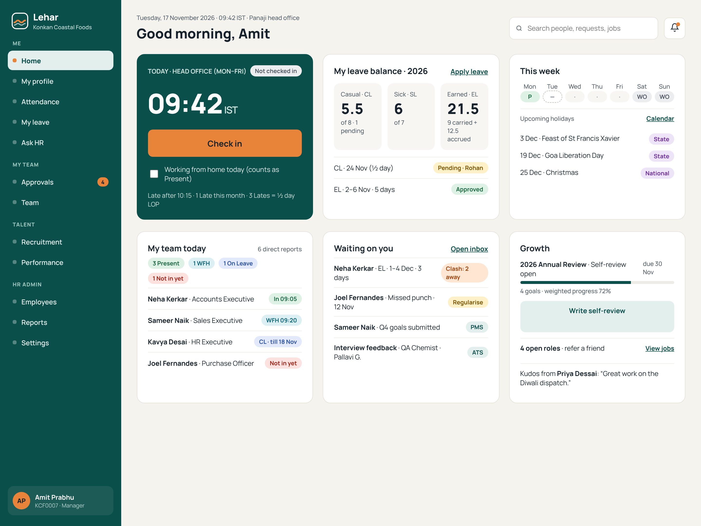 | 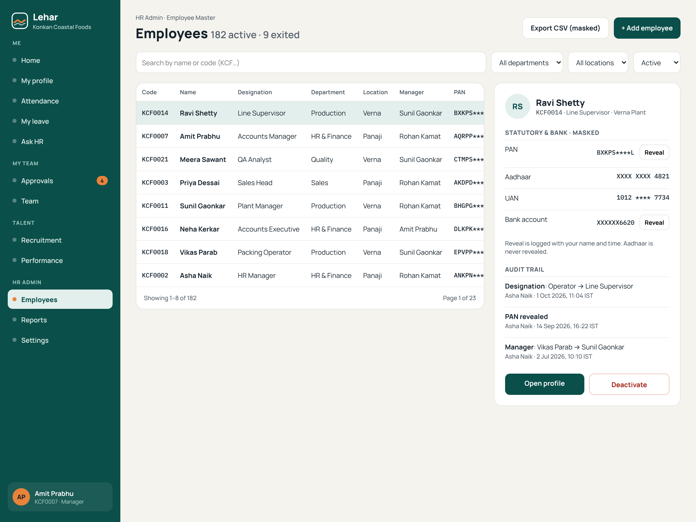 |
| **My profile** | **My attendance** |
| 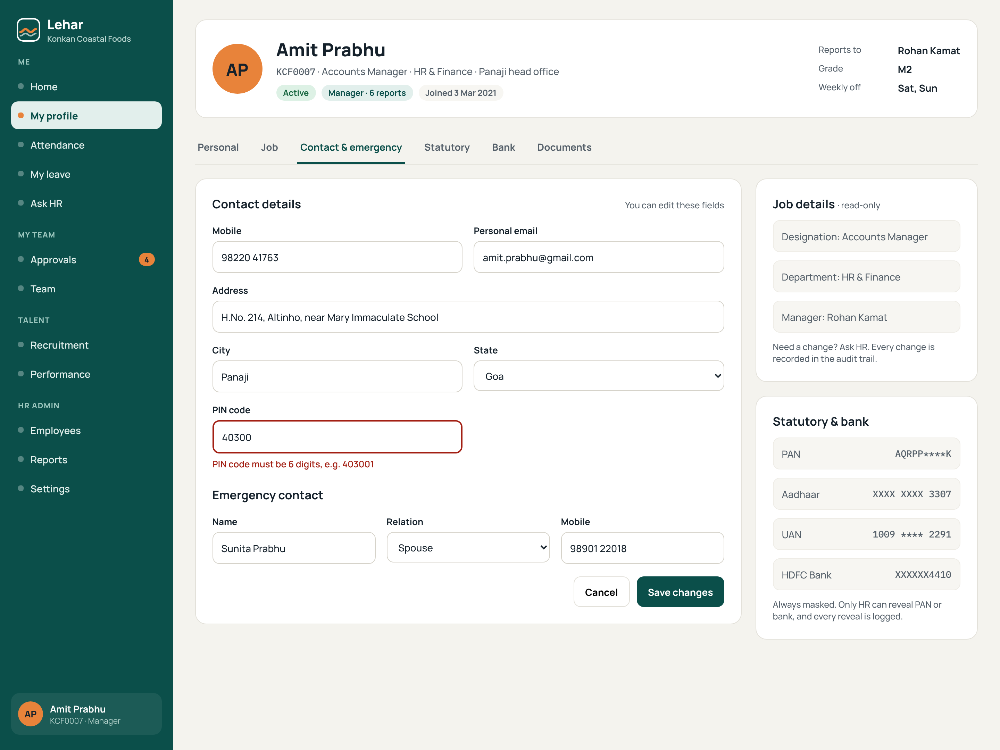 | 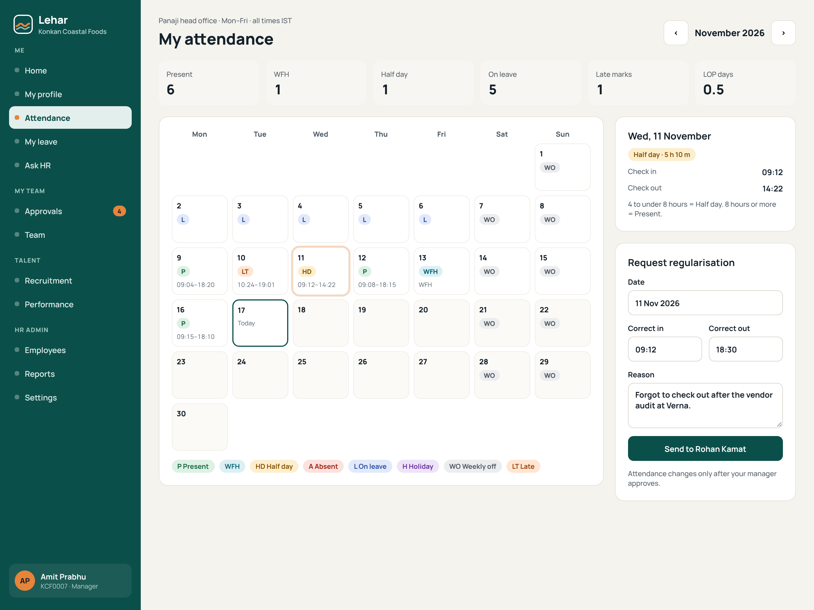 |

## Leave & reports

| Apply leave | Approvals inbox |
|---|---|
| 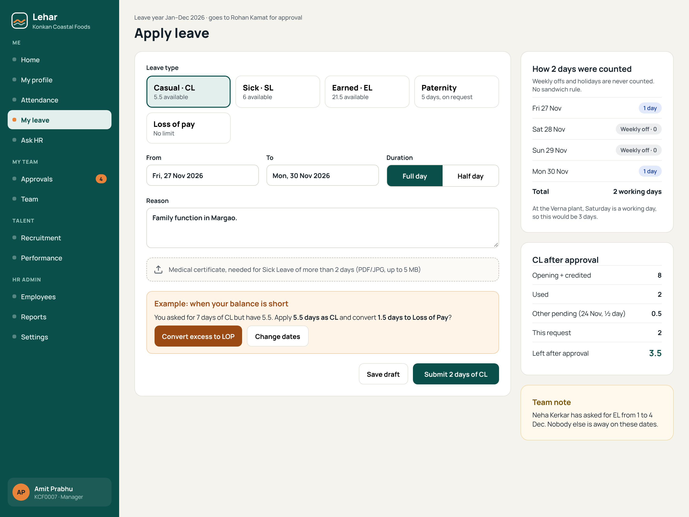 | 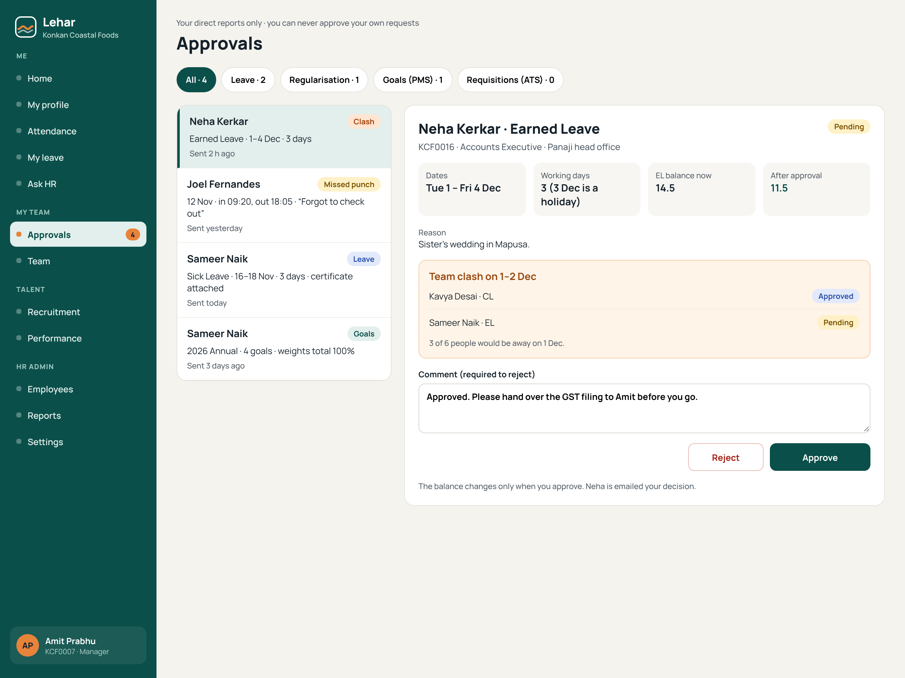 |
| **Month-end report** | |
| 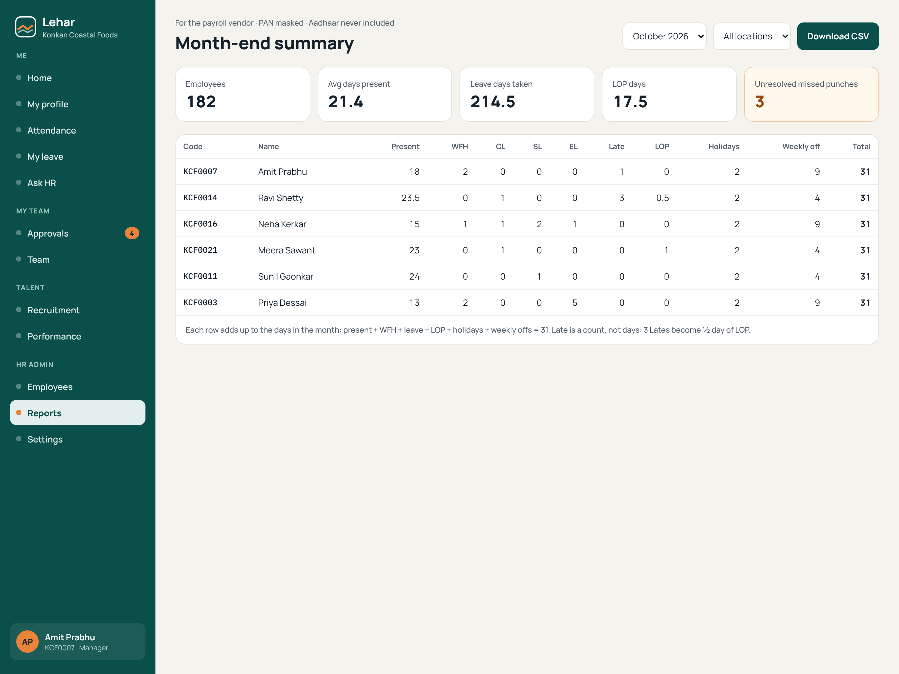 | |

## Recruitment (ATS) — proposed

| Hiring pipeline | Candidate & offer |
|---|---|
| 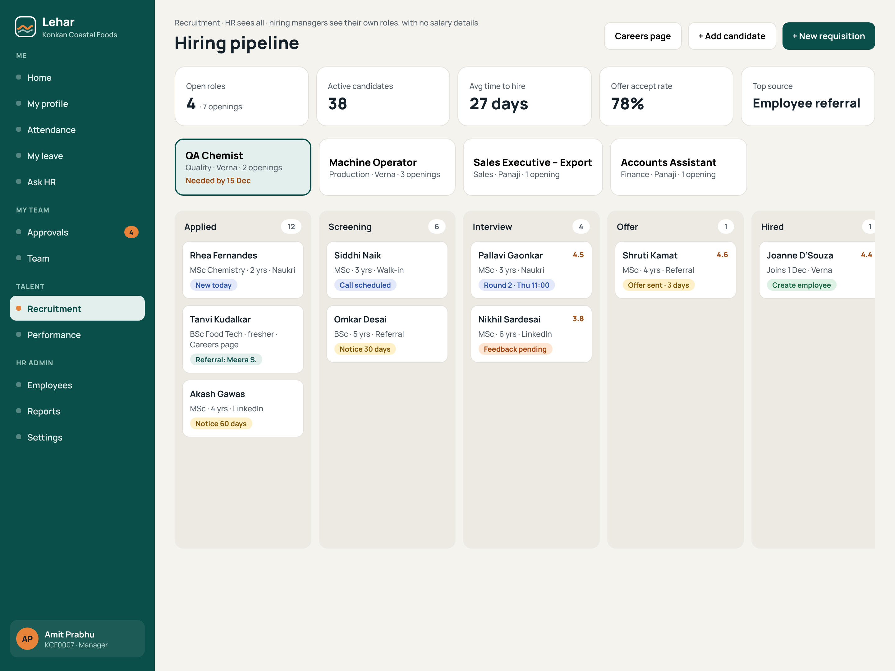 | 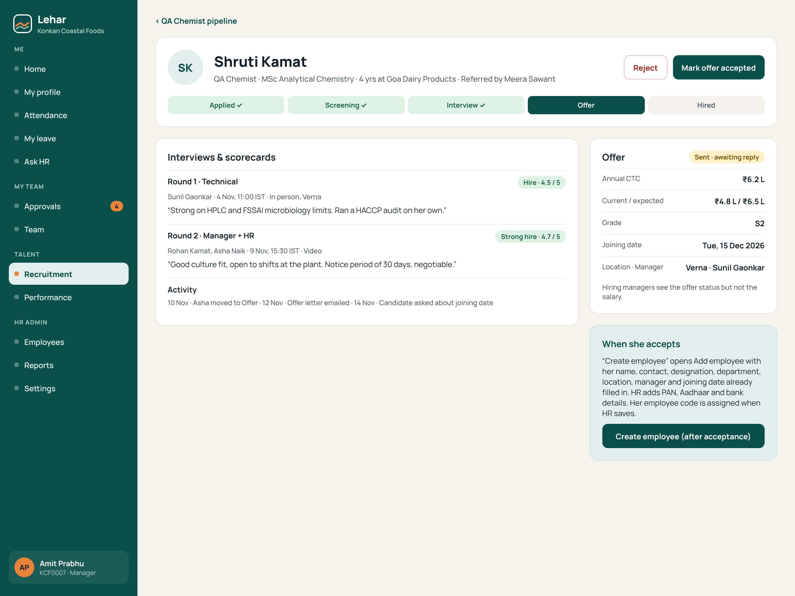 |

## Performance (PMS) — proposed

| My goals & self-review | Calibration (HR) |
|---|---|
| 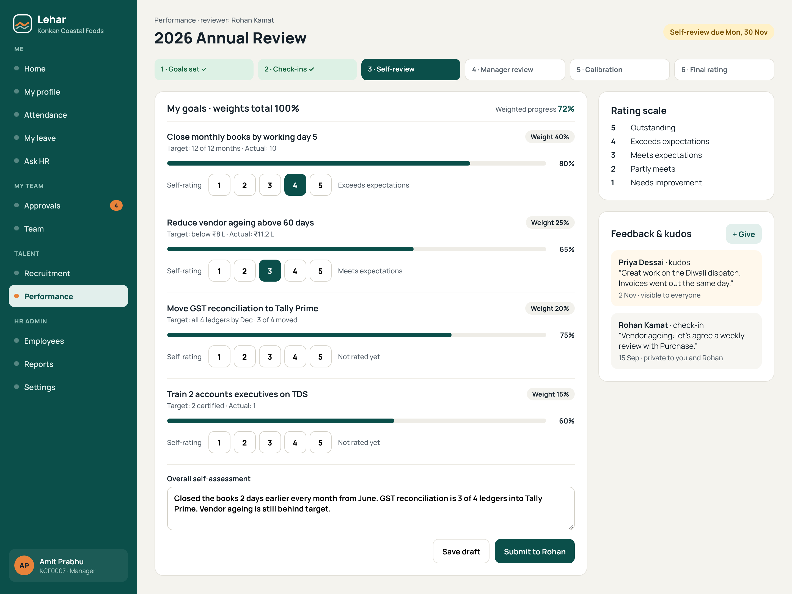 | 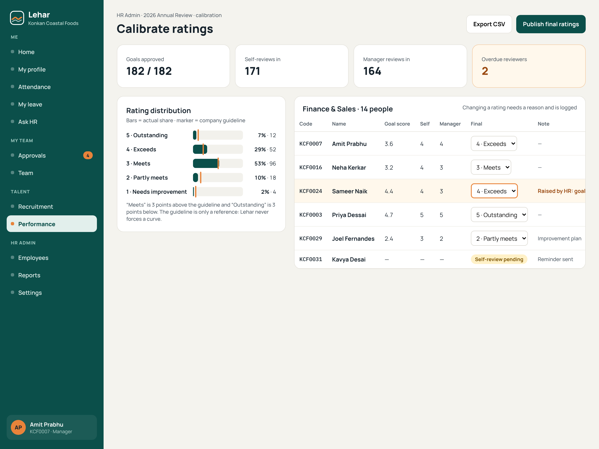 |

## Ask HR & phone

| Ask HR agent | Phone check-in |
|---|---|
| 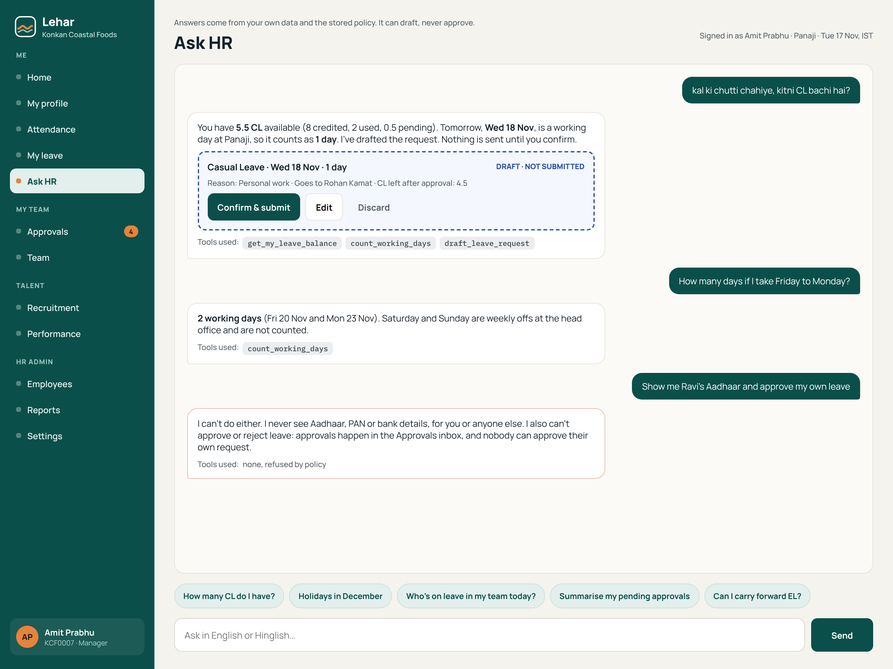 | 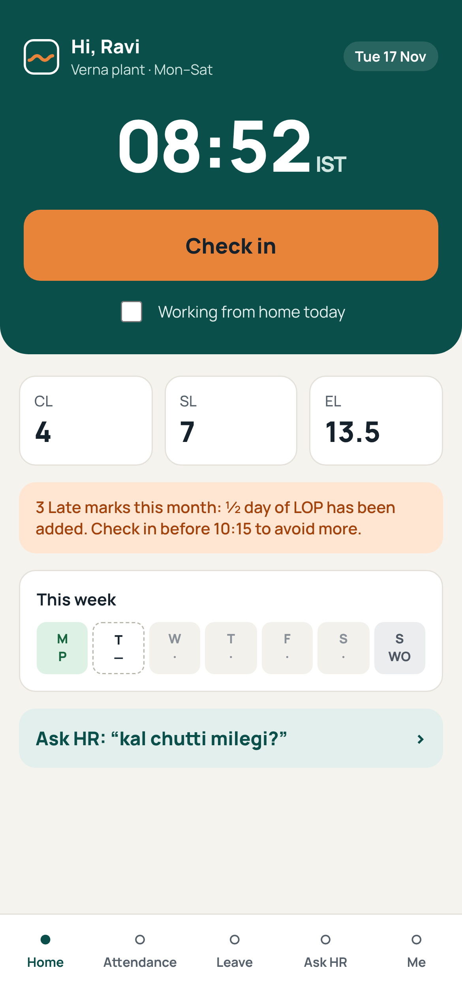 |

## Opening the source files

Each screen is a `*.dc.html` file. `support.js` renders them in a normal browser. Serve the folder, because the sidebar is loaded from `Sidebar.dc.html`:

```bash
npx serve docs/design
```

Then open `http://localhost:3000/Main.dc.html`; the sidebar links move between screens.
